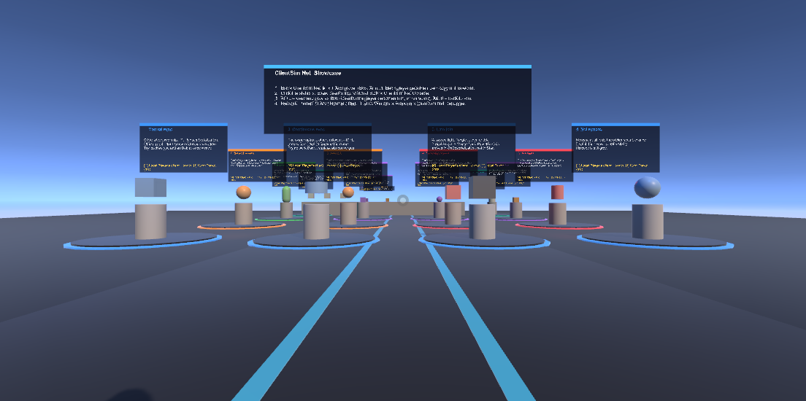
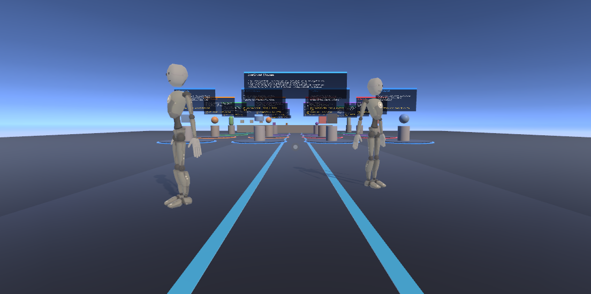
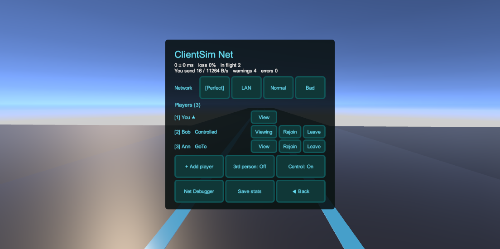
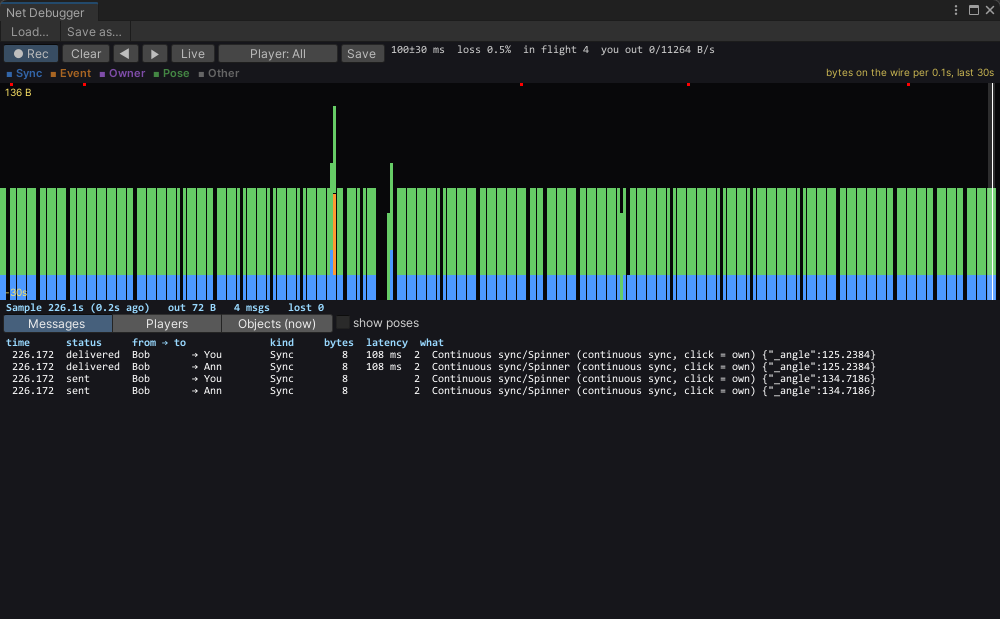

# ClientSim Net

Multiplayer network simulator for VRChat's **ClientSim**. Test networked UdonSharp in one Unity editor, before you upload.

Stock ClientSim has no latency, no `OnDeserialization`, and runs `Owner`/`Others` events locally, so most networking bugs stay hidden. ClientSim Net adds **remote puppet players**, each with their own copy of the world, and sends everything through a simulated network.



## Features

- **Remote puppet players**, each running their own copy of the world: their Udon sees `Networking.LocalPlayer`, `IsOwner` and `IsMaster` as them.
- **Real network path**: `RequestSerialization` and `OnDeserialization` with latency, jitter and packet loss. Presets: Perfect, LAN, Normal, Bad.
- **VRChat limits**: manual sync (280,496 B) and continuous sync (~200 B, 10 Hz) size limits, `[NetworkCallable]` rate limit (5/s), ~11 KB/s bandwidth warning.
- **Ownership and events**: `All`/`Others`/`Owner`/`Self` targets, `OnOwnershipRequest` on both sides, ownership races, master and player leave, late join.
- **Pickups and PlayerObjects**: pickups with and without `VRCObjectSync`, per-player `VRCPlayerObject` copies.
- **View as any player**: switch the Game view to a puppet's world, or take control of them. Other players appear there as named capsules.
- **Net Debugger**: a Profiler-style timeline of every message on the wire.
- **Scripting API** (`NetSimApi`) and a `clientsim_net` unity-mcp tool for automated checks, plus `AGENTS.md` for AI agents.



## Install

**VCC / ALCOM** (recommended): add `https://vpm.logiccuteguy.com/index.json`, then add **ClientSim Net** to your project.

**Unity Package Manager**: **Window > Package Manager > + > Add package from git URL**:

```text
https://github.com/LogicCuteGuy/ClientSimNet.git#0.1.2
```

Requires Unity 2022.3 and the VRChat Worlds SDK 3.10.0 or newer. Use one installation method per project.

## Quick start

1. In **Package Manager > ClientSim Net > Samples**, import **Test World** and open `NetSimShowcase.unity`.
2. Press **Play**.
3. Open the ClientSim menu and press **ClientSim Net ▶** (or use **VRChat SDK > ClientSim Net**). Pick a network preset and **+ Add player**.
4. Interact with the stations, then press **View** next to a player to see their copy of the world.



Shortcuts: Alt+1..9 view a player, Alt+0 view yourself, Alt+[ / ] cycle, Alt+T third person, Alt+C toggle **Control**.

## Net Debugger

Open **Window > Analysis > ClientSim Net Debugger**. It shows bytes on the wire per 0.1 s for the last 30 s, by kind (Sync, Event, Owner, Pose). Click a sample to list its messages with sender, receiver, size, latency and payload.



## Testing from code

```csharp
using ClientSimNet;

NetSimApi.Preset("Perfect");
NetSimApi.AddPlayer("Bob");
NetSimApi.Interact("Counter");
NetSimApi.Flush();                 // deliver everything in flight now
return NetSimApi.ReportJson();     // errors, owners, inSync per object, log
```

See [AGENTS.md](AGENTS.md) for the full workflow, the scenario checklist and the `clientsim_net` tool.

## Differences from VRChat

Puppets have no wall collision, voice and avatars are not simulated, and sync sizes are an estimate rather than real wire bytes. Each player's world costs a full scene copy.

## Docs

[docs.logiccuteguy.com/unity-vrc/clientsimnet/intro](https://docs.logiccuteguy.com/unity-vrc/clientsimnet/intro)

## License

MIT, see [LICENSE](LICENSE).
